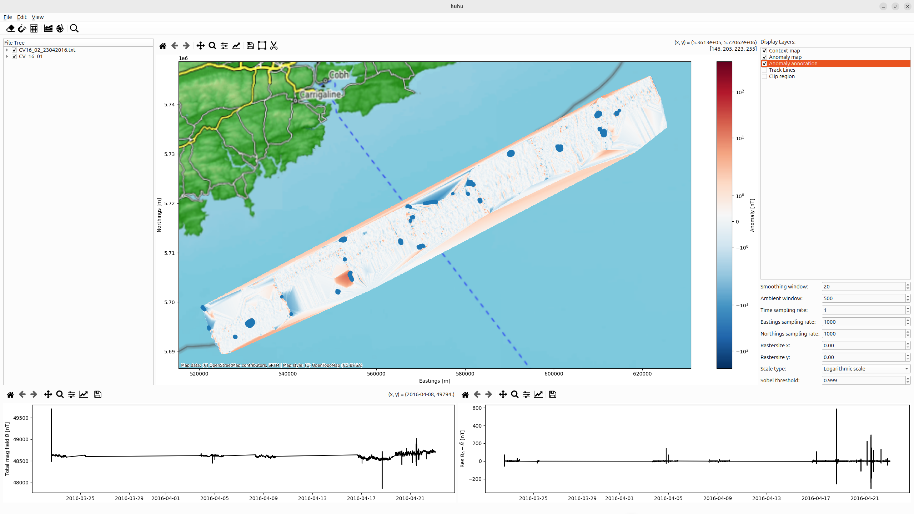

.. _sec:AnomalyDetection:

Anomaly detection
=================

.. |search_icon| image:: ../_static/icons/search-icon.png
   :height: 1em

The Search tool (|search_icon|) detects anomalies using a `Sobel filter <https://en.wikipedia.org/wiki/Sobel_operator>`_, which identifies edges by measuring changes in image intensity through gradient magnitudes.
The resulting magnitudes are thresholded using a configurable percentile.
Adjusting this value helps control the sensitivity of anomaly detection and reduce artifacts.

Locations with magnitudes exceeding the threshold are displayed as blue dots over the anomaly grid when the corresponding layer is selected (see :numref:`fig:AnomalyDetection`).

.. _fig:AnomalyDetection:

   Detected anomalies displayed as blue points ontop of the residual grid.
