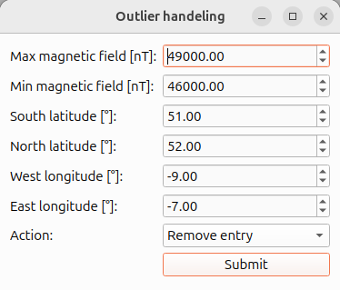

.. _sec:CoarseClipping:

Coarse clipping and outlier removal
===================================

.. |eraser-icon| image:: ../_static/icons/eraser-icon.png
   :height: 1em

The |eraser-icon| tool provides a coarse outlier removal mechanism for identifying and handling invalid or unwanted magnetic field measurements.
It offers two filtering criteria:

- Spatial constraint: A user-defined bounding box specifying the valid spatial region.
- Magnetic field constraints: A user-defined interval specifying the valid range of magnetic field values.

Measurements that do not satisfy both criteria are considered outliers.
Depending on the selected processing option, these measurements can either be removed from the dataset or replaced by interpolated values based on neighbouring valid measurements.

.. _fig:OutlierHandlingDialog:

   The outlier handling dialog allows users to define spatial boundaries and a valid range of magnetic field values.
   Measurements that fall outside either constraint can subsequently be removed or interpolated using neighbouring valid measurements.

