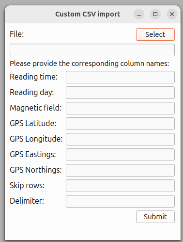

.. _sec:CustomImport:

Custom .csv
===========

Surveys acquired using other acquisition software can be imported via the custom import functionality, provided that the data are available in ``*.csv`` format and meet the following requirements:

- Every row must contain the same number of columns.
- Special characters or markers used to indicate missing values or other exceptional conditions must be replaced with empty fields. In other words, the corresponding field must be left empty.
- The file must contain a header row that specifies the name of each column.

To import a survey, select the custom CSV import option from the ``File`` drop-down menu.
This opens a dialog (see :numref:`fig:custom_csv_import_dialog`) in which the CSV file can be selected.
Furthermore, this dialog allows to specify which columns contain the information required by the software, such as timestamps, longitude, latitude, etc.

.. _fig:custom_csv_import_dialog:

   The custom CSV import dialog allows users to assign CSV columns to the corresponding data fields, such as time, longitude, and latitude.
