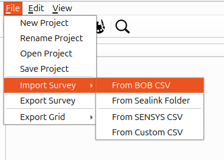
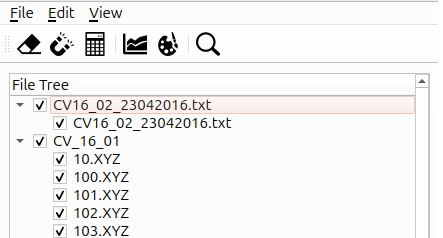

Data import
===========

The software supports importing data files acquired using the following acquisition software:

- Marine Magnetics' SeaLink
- `Bob Survey Software <https://bob.marinemagnetics.com/>`_
- `SENSYS <https://sensysmagnetometer.com/>`_.

For data files in other formats, a custom import option is available.
It allows users to specify which columns contain the relevant data and how they should be interpreted.

To import survey data, select the corresponding accusation software (see :numref:`fig:FileImportDropdown`) from the ``File`` drop-down menu.
A file selection dialog will open, allowing you to select the data file or files to import.

For details on the expected file formats and the assumptions made during import, refer to :ref:`sec:SeaLinkImport`, :ref:`sec:BobImport`, :ref:`sec:SensysImport` files, and :ref:`sec:CustomImport`.

.. _fig:FileImportDropdown:

   The ``File`` drop-down menu provides options for selecting the acquisition software or the custom import method.

.. note::
   Importing large ``*.csv`` or ``*.txt`` files, as well as importing a large numbers of ``*.XYZ`` files, may take some time.

Successfully imported surveys appear will appear in a tree structure on the left-hand site of the main window (see :numref:`fig:FileTree`).
The number of leaves for a single survey reflects whether the individual acquisition lines have been stored in separate files or combined into a single file.
Again, for details on that and the import process in general, we refer to :ref:`sec:SeaLinkImport`, :ref:`sec:BobImport`, :ref:`sec:SensysImport` files, as well as a :ref:`sec:CustomImport`.

.. _fig:FileTree:

   Example of the file tree displayed after successfully importing survey data.

.. toctree::
   :maxdepth: 3

   sealink
   bob
   sensys
   custom_csv